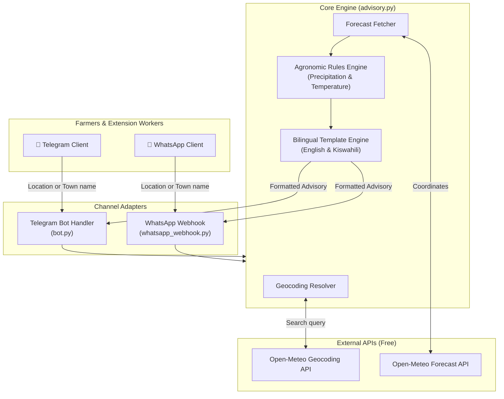

# 🌾 DWAS Weather Advisory Bot (Digital Weather Advisory Service)

[](https://github.com/arumy56/-weather-advisory-bot-/actions)
[](https://www.python.org/)
[](https://opensource.org/licenses/MIT)
[](https://open-meteo.com/)
[](https://telegram.org)

An open-source, conversational **Digital Weather Advisory Service (DWAS)** chatbot designed for smallholder farmers and agricultural extension officers. It delivers hyper-local 3-day weather forecasts coupled with actionable agro-meteorological advisories in **English** and **Kiswahili**.

The project directly mirrors operational DWAS implementations deployed across East Africa (such as Kenya and Tanzania), translating raw weather data into practical farming decisions (e.g., spraying, fertilizer application, irrigation, mulching, and planting).

---

## 🚀 Key Features

- **Free, Keyless Weather & Geocoding**: Powered by [Open-Meteo](https://open-meteo.com/), eliminating the need for paid API keys or complex quotas.
- **Bilingual Support (English & Kiswahili)**: Seamless toggle between languages using `/en` and `/sw`.
- **Flexible Location Input**:
  - 📍 **GPS Pin Sharing**: Instant pin drop using Telegram or WhatsApp native location picker.
  - 🔍 **Town / Village Search**: Automatic fuzzy geocoding (e.g., *Eldoret*, *Nakuru*, *Machakos*, *Mbeya*).
- **Rule-Based Agronomic Decision Engine**:
  - 🚨 **Heavy Rain (≥ 20mm/day)**: Warns of soil waterlogging; advises delaying pesticides/foliar spraying and fertilizer application to prevent chemical runoff and nutrient leaching.
  - ☀️ **Dry Spell (< 2mm total / 3 days)**: Alerts farmers to moisture deficits; recommends supplemental irrigation, organic mulching, and postponing delicate seedling transplantation.
  - 🌱 **Normal / Moderate Moisture**: Confirms optimal conditions for field preparation, top-dressing, and weeding.
- **Dual Platform Architecture**:
  - **Telegram Bot** (`bot.py`): Long-polling or webhook with interactive reply buttons.
  - **WhatsApp Webhook** (`whatsapp_webhook.py`): FastAPI service supporting Meta Cloud API and Twilio WhatsApp Sandbox.
- **Production-Ready**:
  - Fully containerized with `Dockerfile` and `docker-compose.yml`.
  - Comprehensive unit test suite (`pytest` + `pytest-asyncio`).
  - GitHub Actions CI pipeline testing across multiple Python versions.

---

## 🏛️ System Architecture



---

## 📂 Project Structure

```text
├── advisory.py               # Core domain logic: Geocoding, weather fetch, & ag-rules
├── bot.py                    # Telegram bot polling service & UI keyboard
├── whatsapp_webhook.py       # FastAPI webhook for Meta WhatsApp Cloud API & Twilio
├── tests/
│   └── test_advisory.py      # Unit tests for advisory logic & mock API calls
├── .github/
│   └── workflows/
│       └── ci.yml            # Automated GitHub Actions test pipeline
├── Dockerfile                # Multi-stage production container
├── docker-compose.yml        # Orchestration for Telegram & WhatsApp services
├── requirements.txt          # Python dependencies
├── .env.example              # Environment variables template
├── .gitignore                # Git ignore patterns
└── README.md                 # Project documentation
```

---

## 🛠️ Quickstart Guide

### 1. Clone & Set Up Virtual Environment

```bash
git clone git@github.com:arumy56/-weather-advisory-bot-.git
cd -weather-advisory-bot-

python3 -m venv .venv
source .venv/bin/activate
pip install -r requirements.txt
```

### 2. Configure Environment Variables

Copy the template:
```bash
cp .env.example .env
```

Edit `.env` and add your Telegram Bot token:
```env
# Get from @BotFather on Telegram
TELEGRAM_TOKEN=123456789:ABCdefGhIJKlmNoPQRsTUVwxyZ

# Optional: WhatsApp Cloud API
WHATSAPP_TOKEN=your_token
WHATSAPP_PHONE_NUMBER_ID=your_id
WHATSAPP_VERIFY_TOKEN=dwas_secret_token
```

### 3. Run the Telegram Bot

```bash
python bot.py
```

Open Telegram, search for your bot, and send `/start` or tap **📍 Share Location (GPS)**!

---

## 💬 Sample User Interaction

### English (`/en`):
```text
Farmer: Eldoret
Bot:    📍 Weather Advisory for Eldoret, Kenya (Next 3 Days)
        • 2026-11-11: 🌡️ Max 22.4°C | 🌧️ Rain: 3.2 mm
        • 2026-11-12: 🌡️ Max 20.1°C | 🌧️ Rain: 24.5 mm
        • 2026-11-13: 🌡️ Max 23.0°C | 🌧️ Rain: 1.0 mm

        🚜 Agronomic Recommendation:
        🚨 Heavy Rain Alert (2026-11-12): Soil saturation risk. Delay foliar
        spraying, pesticides, and synthetic fertilizer application to prevent
        chemical runoff and nutrient leaching. Ensure field drainage channels are clear.
```

### Kiswahili (`/sw`):
```text
Farmer: /sw
Bot:    🌾 Karibu kwenye Huduma ya Ushauri wa Hali ya Hewa Kilimo (DWAS)...

Farmer: Kitale
Bot:    📍 Ushauri wa Hali ya Hewa: Kitale, Kenya (Siku 3 Zijazo)
        • 2026-11-11: 🌡️ Joto 24.0°C | 🌧️ Mvua: 0.0 mm
        • 2026-11-12: 🌡️ Joto 25.2°C | 🌧️ Mvua: 0.5 mm
        • 2026-11-13: 🌡️ Joto 26.0°C | 🌧️ Mvua: 0.2 mm

        🚜 Ushauri wa Kilimo:
        ☀️ Tahadhari ya Ukame: Mvua kidogo sana (chini ya mm 0.7 kwa siku 3).
        Zingatia umwagiliaji, weka matandazo (mulching) kuhifadhi unyevu udongoni,
        na epuka kupandikiza miche michanga.
```

---

## 🐳 Running with Docker

Run both Telegram bot and WhatsApp webhook services with one command:

```bash
docker compose up --build -d
```

Check container logs:
```bash
docker compose logs -f telegram-bot
```

---

## 🧪 Running Unit Tests

Run the test suite using `pytest`:

```bash
pytest -v
```

Output:
```text
tests/test_advisory.py::test_advise_heavy_rain_english PASSED
tests/test_advisory.py::test_advise_heavy_rain_swahili PASSED
tests/test_advisory.py::test_advise_dry_spell PASSED
tests/test_advisory.py::test_advise_moderate_weather PASSED
tests/test_advisory.py::test_advise_empty_daily PASSED
tests/test_advisory.py::test_geocode_success PASSED
tests/test_advisory.py::test_geocode_not_found PASSED
tests/test_advisory.py::test_forecast_fetch PASSED
========================== 8 passed in 0.12s ==========================
```

---

## 📄 License

This project is licensed under the MIT License - see the [LICENSE](LICENSE) file for details.
